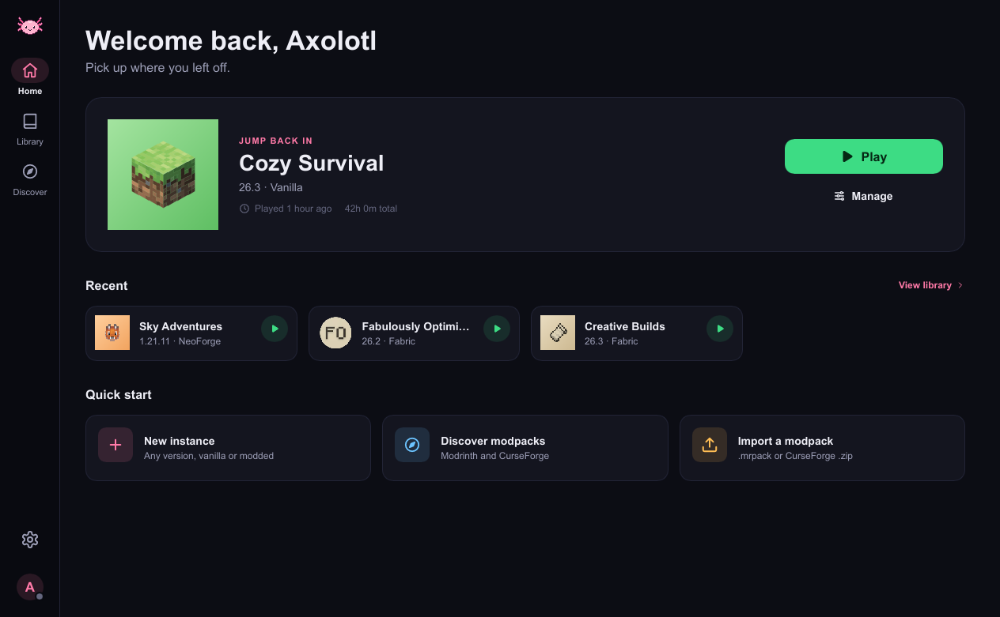
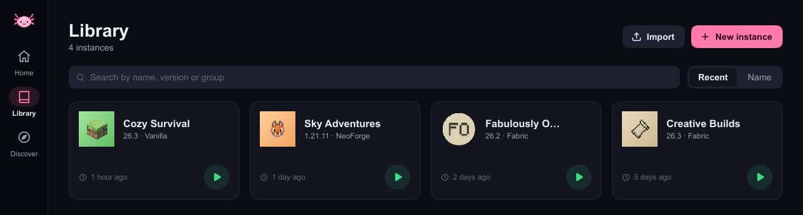
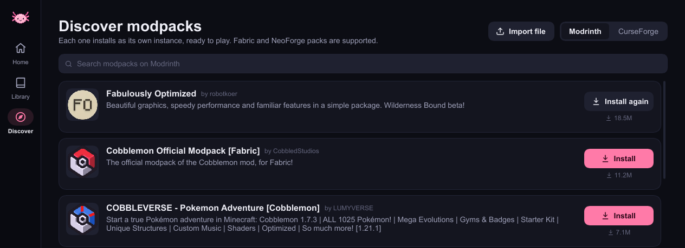

<div align="center">


# Axi Launcher

**A small launcher with big features.**

A cozy little Minecraft launcher, named after everyone's favourite smiley salamander.
It stays out of your way, sips memory instead of gulping it, and makes playing with mods feel easy.

</div>

<p align="center">
  
</p>

## 🩷 Why Axi?

Axolotls are small, calm and surprisingly tough, and that's what Axi aims for too.

- **Tiny footprint.** Sitting idle, Axi uses around **50 MB of RAM**. Leave it open while you play and your game keeps the memory.
- **Pretty and simple.** One clean, friendly interface. No cluttered menus, no hunting for buttons.
- **Mods without the mess.** Find, install and update mods, modpacks, resource packs and shaders right inside the launcher.

## ✨ Features

- 🎮 **Vanilla, Fabric and NeoForge**: any Minecraft version from 1.13 onward
- 📦 **Modpacks** from Modrinth and CurseForge, installed in one click
- 📥 **Import packs** you already have (`.mrpack` or CurseForge `.zip`)
- 🧩 **Mods, resource packs and shaders**, with update checks and one-click updates
- 🌅 **Shaders made easy**: Axi can set up the shader loader for you
- 🗂️ **A tidy library** of all your instances, with search, sorting, groups and custom pictures
- ☕ **Java handled for you**: the right version is downloaded automatically
- 👤 **Microsoft and offline accounts**, with your skin's face on show
- ⏱️ **Play time tracking** and a "jump back in" button for your latest world
- 🪶 **Light on your PC**: low memory, no background bloat

## 🖼️ A peek inside

<p align="center">
  
</p>

<p align="center">
  
</p>

## 🚀 Getting started

1. Download and open Axi.
2. Sign in with your Microsoft account (or add an offline name).
3. Make a new instance, or grab a modpack from **Discover**.
4. Press **Play**. That's it! 🎉

## 🛠️ Building it yourself

You'll need [Rust](https://rustup.rs). Then:

```bash
cargo run --release -p axi-app
```

Microsoft sign-in and CurseForge browsing need keys, which are kept out of this repository.
Provide them when you build, as environment variables (or under `[env]` in your own `~/.cargo/config.toml`):

| Variable | What it's for |
| --- | --- |
| `AXI_MSA_CLIENT_ID` | Your Azure app's client ID, for Microsoft sign-in |
| `AXI_CURSEFORGE_API_KEY` | A CurseForge API key, for browsing CurseForge |

Both can also be entered later in Axi's **Settings**.

### 📦 Release builds

| Platform | Command | Output |
| --- | --- | --- |
| Windows 64-bit | `cargo build --release -p axi-app --target x86_64-pc-windows-msvc` | `axi-launcher.exe` (no VC++ redistributable needed) |
| macOS Apple Silicon | `packaging/macos/bundle.sh` (on a Mac) | `Axi Launcher.app` and a `.dmg` |

GitHub Actions builds both on every push, and drafts a release with them when you push a `v*` tag.
Add `AXI_MSA_CLIENT_ID` and `AXI_CURSEFORGE_API_KEY` as repository secrets to bake the keys into those builds.

The Mac build is ad-hoc signed, not notarized, so the first launch needs a right-click → **Open**.
On Apple Silicon, Minecraft 1.13–1.18 runs on an Intel Java through Rosetta 2 (their graphics libraries have no arm64 build); 1.19+ runs natively.

<div align="center">

Made with 🩷 and a lot of axolotl energy.

*Axi is not affiliated with Mojang or Microsoft. Minecraft is a trademark of Mojang AB.*

</div>
